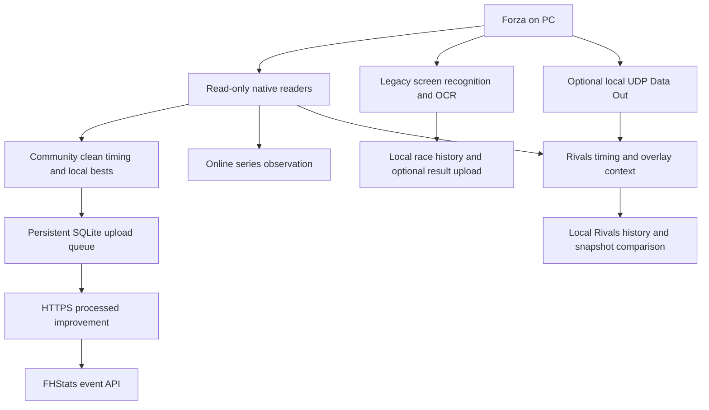

# How it works

## Capture paths

Community EventLab detection and timing use native game memory. Known blueprints are matched to their registered identities; car, class and PI are read from the active context. Clean improvements are saved per track, car and class. Complete circuits and point-to-point runs have different finish rules, and interrupted attempts must not overwrite clean bests.

The online series observer is separate from legacy result capture. It can resolve known route IDs to English names, but observed class candidates are not automatically treated as a verified series restriction. Do not describe this as complete native online result capture.

Rivals uses its own native recognition and telemetry timing path. Published ranks are comparisons with dated FHStats snapshots, not a live official Forza leaderboard feed. Recognition, sectors and finish coverage vary by route.

## Repository structure

| Path | Responsibility |
| :--- | :--- |
| `apps/tracker-desktop/src/forza_tracker/ui/` | Tk desktop pages, community panels, history, Rivals and settings |
| `creator_capture.py`, `creator_memory.py`, `creator_car_memory.py` | Native community context and clean timing |
| `creator_store.py`, `creator_game_sync.py` | Durable personal bests, queued game submissions and receipts |
| `online_series*.py` | Native series observations and track IDs |
| `rivals*.py` | Personal Rivals capture, timing and references |
| `capture/`, `detector/`, `parser/` | Legacy screen capture, template matching and OCR |
| `telemetry/`, `overlay/`, `recording/` | Optional local telemetry, overlay and video support |
| `localization/` | English and Spanish desktop text |
| `config/`, `templates/`, `data/canonical/` | Defaults and public recognition or reference data |
| `tests/` | Public desktop tests without the hosted API implementation |
| `scripts/check_desktop_startup.py` | Isolated construction and navigation check |

Some garage data models and compatibility helpers remain for existing files. Automatic scanning, its runner and its navigation page are retired. Private automation code and resources are not part of this source tree.

The website, API, event point calculations and Xbox receiver are hosted separately. This repository does not expose server credentials or owner operations, and it cannot be used to reproduce the entire hosted FHStats service by itself.
